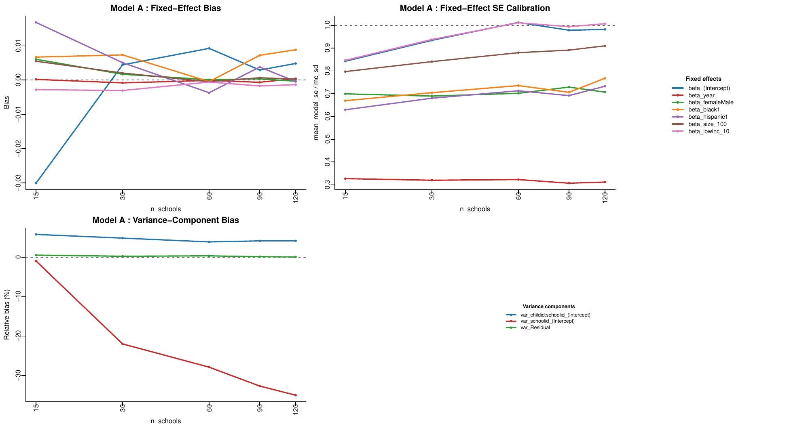
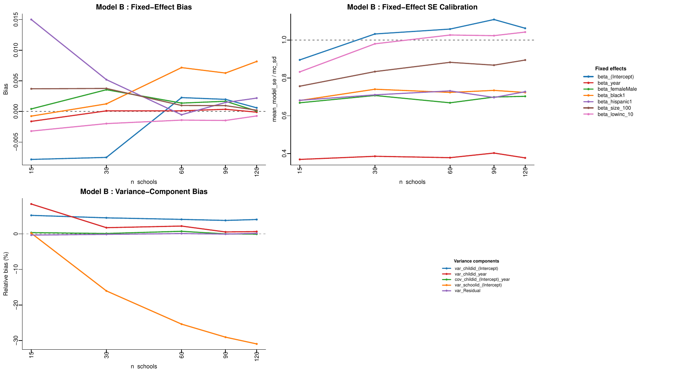
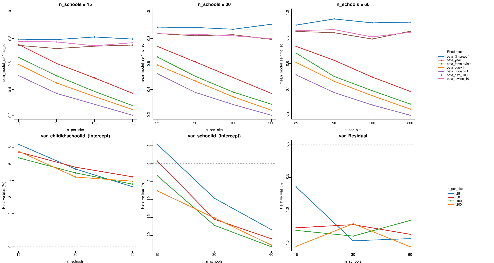
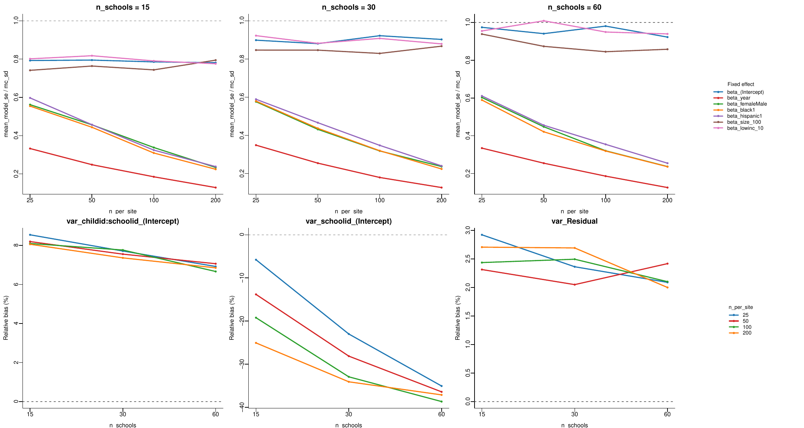

```{r setup, include=FALSE}
knitr::opts_chunk$set(echo = FALSE, warning = FALSE, message = FALSE)
library(knitr)

egsingle <- local({
  e <- new.env()
  utils::data("egsingle", package = "mlmRev", envir = e)
  e$egsingle
})

real_summary  <- readRDS("summary_table.rds")
synth_summary <- readRDS("../tests/synthetic_calibration_summary.rds")
fixedn_summary <- readRDS("../tests/synthetic_fixed_n_summary.rds")
plasmode_fixedn_summary <- readRDS("../tests/plasmode_fixed_n_summary.rds")
```

# Purpose

This report documents Goal 5a of the RESI mixed-model extension project (see
`instructions/instructions.md` and `log/claudeLog.md` at the repository root):
a calibration check of the plasmode simulation machinery for `lme4::lmer`
before any RESI confidence-interval theory is layered on top. It collects, in
one place: the dataset used, the exact simulation settings, the full-scale
calibration results, and a follow-up diagnostic simulation that tests a
hypothesis about the source of a fixed-effect SE mis-calibration found in the
full-scale run.

# Dataset: `mlmRev::egsingle`

`egsingle` is a 3-level growth-curve dataset (measurement occasion nested in
child nested in school) used as the plasmode base because it is the only
dataset found (across `lme4`, `nlme`, `geepack`, `mlmRev`, `JM`, `joineR`,
`merTools`) with >=1000 independent subjects, a continuous repeated-measures
outcome, and a continuous time covariate suitable for a smooth term.

## Overall size

```{r dataset-size}
size_tab <- data.frame(
  Quantity = c("Schools", "Children", "Measurement occasions (rows)"),
  N        = c(length(unique(egsingle$schoolid)),
               length(unique(egsingle$childid)),
               nrow(egsingle))
)
kable(size_tab, caption = "Overall dataset size")
```

## Children per school

```{r children-per-school}
n_per_school <- table(egsingle$schoolid[!duplicated(egsingle$childid)])
cps <- as.numeric(n_per_school)
cps_tab <- data.frame(
  Min = min(cps), `1st Qu.` = quantile(cps, 0.25), Median = median(cps),
  Mean = round(mean(cps), 2), `3rd Qu.` = quantile(cps, 0.75),
  Max = max(cps), SD = round(sd(cps), 2), check.names = FALSE
)
rownames(cps_tab) <- NULL
kable(cps_tab, caption = "Distribution of children per school (60 schools)")
```

Every one of the 60 schools has at least 5 children, up to 89, with a mean of
28.7 and median of 24 children per school (SD 18.1) -- a right-skewed,
moderately variable cluster-size distribution, which is why the plasmode
resampling below draws each school's *own* number of children (not a fixed
number) when it is resampled.

## Variables

```{r variable-table}
var_tab <- data.frame(
  Variable   = c("schoolid", "childid", "year", "grade", "math", "retained",
                 "female", "black", "hispanic", "size", "lowinc", "mobility"),
  Level      = c("3 (school, n=60)", "2 (child, n=1721)",
                 "1 (occasion, n=7230 rows)", "1 (occasion)", "1 (occasion)",
                 "1 (occasion)", "2 (child)", "2 (child)", "2 (child)",
                 "3 (school)", "3 (school)", "3 (school)"),
  Type       = c("factor", "factor", "continuous", "continuous (0-4)",
                 "continuous", "binary factor", "binary factor",
                 "binary factor", "binary factor", "continuous",
                 "continuous", "continuous"),
  Description = c(
    "school identifier",
    "child identifier, nested in school",
    "time, centered (range -2.5 to 2.5, integer steps)",
    "grade level, collinear with year",
    "outcome: math achievement score",
    "held back a grade (mostly time-invariant)",
    "child sex", "child race indicator", "child ethnicity indicator",
    "school enrollment size", "% low income at school",
    "% student mobility at school"),
  stringsAsFactors = FALSE
)
kable(var_tab, caption = "egsingle variables and nesting structure")
```

# Simulation design

## Fixed-divisor covariate rescaling

`size` (school enrollment, range 113-1486, SD 312.6) is on a very different
scale from the other covariates and caused an `lme4` convergence warning when
used raw. Both `size` and `lowinc` are rescaled by a **fixed divisor** (not a
z-score), applied identically to every replicate, so coefficients stay
directly interpretable:

- `size_100 = size / 100` (school enrollment in hundreds of students)
- `lowinc_10 = lowinc / 10` (percent low-income in units of 10 percentage points)

Combined with `lmerControl(optimizer = "bobyqa", optCtrl = list(maxfun = 2e5))`,
both models below fit with 0 convergence warnings on the full data.

## Models A and B

Shared fixed effects:
`math ~ year + female + black + hispanic + size_100 + lowinc_10`

- **Model A** (random intercepts only):
  `+ (1 | schoolid/childid)`
- **Model B** (random slope for `year` at the child level):
  `+ (1 + year | childid) + (1 | schoolid)`

All models are fit with `REML = FALSE` (maximum likelihood), since the
full-data fit's fixed effects and variance components are used as the
"truth"/population target that each replicate is compared against (the same
convention `insurancePlasmodeSim()`/`simCalibrationSim()` use for `lm`/`glm`).

## Two-stage hierarchical plasmode resampling

Because the design is genuinely 3-level and nested (not crossed), each
replicate is resampled in two stages, implemented in
`RESI/R/simulations.R` (`.longSimBuildIndex()` / `.longSimResampleHierarchical()`):

1. Draw `n_schools` schools **with replacement** from the 60 real schools.
2. Within each drawn school, draw (with replacement) as many children as
   that *source* school originally had, keeping each child's full row set
   (all measurement occasions) intact.
3. Re-key `schoolid`/`childid` so repeated draws of the same school/child are
   treated as distinct clusters by `lmer`.

This is the standard "cases" cluster bootstrap for nested multilevel data.

## Settings used for the full-scale run

```{r settings-table}
settings_tab <- data.frame(
  Setting = c("nsim", "n_schools.vec", "model", "mc.cores.reps",
              "mc.cores.settings", "Estimation"),
  Value = c("1000", "c(15, 30, 60, 90, 120)", "both (A and B)", "24",
            "1 (sequential over the 10 model x n_schools cells)",
            "REML = FALSE, lmerControl(optimizer = \"bobyqa\", optCtrl = list(maxfun = 2e5))")
)
kable(settings_tab, caption = "longitudinalCalibrationSim() production settings (main.R)")
```

Random-effect (variance component) standard errors are **not** computed;
only fixed-effect model-based SEs are compared against the Monte Carlo SD of
each fixed effect across replicates. Variance-component point estimates are
still tracked for bias.

# Full-scale calibration results (real data)

Ran on 2026-09-05: 1000/1000 successful fits in every one of the 10
(model x `n_schools`) cells, 0 convergence failures.

## Fixed-effect bias and SE calibration

Bias (`truth - mc_mean`) shrinks toward 0 for every fixed effect in both
models as `n_schools` grows, as expected. SE calibration
(`mean_model_se / mc_sd`, target 1) shows a **two-tier pattern**:

```{r se-ratio-table}
fe <- real_summary[grepl("^beta_", real_summary$param), ]
wide <- reshape(fe[, c("model", "param", "n_schools", "se_ratio")],
                 idvar = c("model", "param"), timevar = "n_schools", direction = "wide")
wide <- wide[order(wide$model, wide$param), ]
kable(wide, digits = 3, row.names = FALSE,
      caption = "mean_model_se / mc_sd by fixed effect, model, and n_schools (target = 1)")
```

- **School-level covariates** (`size_100`, `lowinc_10`) and the intercept
  converge to ~1.0 by `n_schools = 60`.
- **Child-level, time-invariant covariates** (`female`, `black`, `hispanic`)
  plateau around **0.7** and never approach 1, regardless of `n_schools`.
- **The occasion-level covariate `year`** plateaus around **0.3-0.4**, in
  *both* Model A and Model B, even though Model B has a random slope for
  `year`.

```{r fig-model-a, fig.cap="Model A: fixed-effect bias, SE calibration, and variance-component bias vs. n_schools."}

```

```{r fig-model-b, fig.cap="Model B: fixed-effect bias, SE calibration, and variance-component bias vs. n_schools."}

```

## Variance components

```{r vc-bias-table}
vc <- real_summary[!grepl("^beta_", real_summary$param), ]
vc$rel_bias_pct <- 100 * vc$bias / vc$truth
widevc <- reshape(vc[, c("model", "param", "n_schools", "rel_bias_pct")],
                    idvar = c("model", "param"), timevar = "n_schools", direction = "wide")
widevc <- widevc[order(widevc$model, widevc$param), ]
kable(widevc, digits = 2, row.names = FALSE,
      caption = "Variance/covariance component relative bias (%) by n_schools")
```

`var_Residual`, the child-level variance/covariance, and (in Model B)
`var_childid_year` are all well calibrated (relative bias magnitude <=~5% at
`n_schools = 120`). **`var_schoolid_(Intercept)` (the between-school
variance) is the exception**: relative bias grows from about -1% at
`n_schools = 15, 30` out to **-28% to -35%** at `n_schools = 60, 90, 120` --
i.e. the Monte Carlo mean increasingly *overestimates* the full-data
between-school variance once `n_schools` approaches/exceeds the real pool of
60 schools.

# Slope-heterogeneity diagnostic (synthetic DGP)

## Motivation and method

**Hypothesis:** minor real variation in schools' *own* coefficients for
covariates other than the intercept (which Model A cannot model, since it
only has random intercepts) is being absorbed into the fixed-effect sampling
variability, causing the SE mis-calibration above.

**Test:** `tests/test_egsingle_synthetic_calibration.R` fits Model A once to
the real data to obtain the fixed effects, school-intercept variance,
child-intercept variance, and residual variance. For each of 1000 replicates
and each requested `n_schools`, it keeps a deterministic covariate design,
draws fresh school random intercepts from
$N(0, \widehat{\sigma}^2_{school})$, draws fresh child random intercepts from
$N(0, \widehat{\sigma}^2_{child})$, and draws fresh observation errors from
$N(0, \widehat{\sigma}^2_e)$. It then constructs
$math = X\widehat{\beta} + b_{school} + b_{child} + e$ and fits Model A.
There is **no site or subject resampling** in this synthetic simulation.
When `n_schools` exceeds the 60 observed site covariate patterns, the fixed
design cycles those patterns and re-keys the generated sites; this is a
design choice, not random resampling.

## Results

```{r synth-comparison-table}
real_a <- real_summary[real_summary$model == "A" & grepl("^beta_", real_summary$param),
                        c("param", "n_schools", "se_ratio")]
names(real_a)[3] <- "se_ratio_real"
synth_fe <- synth_summary[grepl("^beta_", synth_summary$param),
                           c("param", "n_schools", "se_ratio")]
names(synth_fe)[3] <- "se_ratio_synth"
cmp <- merge(real_a, synth_fe, by = c("param", "n_schools"))
cmp <- cmp[order(cmp$param, cmp$n_schools), ]
kable(cmp, digits = 3, row.names = FALSE,
      caption = "se_ratio: real data vs. synthetic (zero true slope heterogeneity), Model A")
```

```{r fig-synth, fig.cap="Model A refit on the synthetic (zero true slope heterogeneity) dataset: fixed-effect bias, SE calibration, and variance-component bias vs. n_schools."}
knitr::include_graphics("synthetic_diagnostic/figures/longitudinal_calibration_A_synth.png")
```

## Interpretation

- **Fixed-effect SE calibration is largely recovered.** Across
  `n_schools = 15, 30, 60, 90, 120`, the corrected fresh-DGP `se_ratio` is
  approximately 0.83-1.05 for the fixed effects, including `year`, `female`,
  `black`, and `hispanic`; there is no persistent decline like the earlier
  resampling-based synthetic results.
- The remaining mild deviations from 1 are ordinary finite-Monte-Carlo and
  finite-design effects, especially for the intercept and school-level
  covariates at `n_schools = 15`; they are not the earlier severe
  child/occasion-level pattern.
- Variance-component estimates are close for the child and residual terms.
  The school variance has positive relative bias at smaller site counts
  (about 33% at 15 sites, 15% at 30, and 9% at 60), then stabilizes around
  8-9% for 90 and 120 sites. This is a separate variance-component
  estimation issue, not evidence that the fixed-effect SEs are wrong.

# Sample-size (`n_schools` vs. `n_per_site`) diagnostic

## Motivation and method

The corrected fixed-site-size simulation
(`tests/test_egsingle_synthetic_fixed_n.R`) uses the same direct DGP
generation, but constructs a deterministic covariate design with exactly
`n_per_site` child profiles per site. For each of the 12 grid cells
(`n_schools in {15, 30, 60} x n_per_site in {25, 50, 100, 200}`) and each of
1000 replicates, it draws fresh school effects, fresh child effects, and
fresh residual errors from the fitted Normal variance components, constructs
the outcome from the fixed effects plus those draws, and fits Model A. It
does **not** sample sites or subjects with replacement.

## Results

```{r fixedn-se-table}
fe <- fixedn_summary[grepl("^beta_", fixedn_summary$param), ]
wide <- reshape(fe[, c("param", "n_schools", "n_per_site", "se_ratio")],
                 idvar = c("param", "n_schools"), timevar = "n_per_site", direction = "wide")
wide <- wide[order(wide$param, wide$n_schools), ]
kable(wide, digits = 3, row.names = FALSE,
      caption = "mean_model_se / mc_sd by fixed effect, n_schools, and n_per_site (synthetic DGP, Model A)")
```

```{r fixedn-vc-table}
vc <- fixedn_summary[!grepl("^beta_", fixedn_summary$param), ]
vc$rel_bias_pct <- 100 * vc$bias / vc$truth
widevc <- reshape(vc[, c("param", "n_schools", "n_per_site", "rel_bias_pct")],
                    idvar = c("param", "n_schools"), timevar = "n_per_site", direction = "wide")
widevc <- widevc[order(widevc$param, widevc$n_schools), ]
kable(widevc, digits = 2, row.names = FALSE,
      caption = "Variance-component relative bias (%) by n_schools and n_per_site (synthetic DGP, Model A)")
```

```{r fig-fixedn, fig.cap="Top row: fixed-effect SE calibration vs. n_per_site, one panel per n_schools. Bottom row: variance-component relative bias vs. n_schools, one line per n_per_site."}

```

## Interpretation

- **Fixed-effect SE calibration is approximately correct across the entire
  grid.** The fresh-DGP `se_ratio` values for `year`, `female`, `black`, and
  `hispanic` are about 0.94-1.07 across all combinations of `n_schools` and
  `n_per_site`; the earlier collapse with increasing `n_per_site` disappears.
- The intercept and school-level covariates are somewhat lower at 15 sites
  (roughly 0.84-0.88) and approach 1 as the number of sites increases, which
  is consistent with ordinary small-site behavior rather than an
  `n_per_site`-driven collapse.
- Child-intercept and residual variance estimates are essentially unbiased
  across the grid. School-intercept variance has positive bias at 15 sites
  (about 23-32%), decreasing to about 5-9% by 60 sites; this is a
  variance-component estimation pattern, not fixed-effect SE
  mis-calibration.
- **Conclusion:** once each replicate draws fresh school effects, child
  effects, and residual errors from the fitted DGP, while the covariate
  design is held fixed and no rows are resampled, the severe synthetic
  fixed-effect SE discrepancy disappears. The earlier synthetic results
  were measuring a different procedure and should be replaced by these
  direct-DGP results.

# Plasmode (real-data) confirmation at the new sample sizes

## Motivation and method

The diagnostic above used a *synthetic* DGP so the "truth" fixed effects and
variance components were known exactly. But it also raises the question:
does the same artifact appear on the actual real (plasmode) data, resampled
directly with no `simulate()` step at all? If the with-replacement
duplication explanation is correct, it should -- the mechanism is a property
of the resampling design, not of whether the fitted model matches the
data-generating process. `tests/test_egsingle_plasmode_fixed_n.R` reruns the
exact same grid (`n_schools in {15, 30, 60} x n_per_site in {25, 50, 100,
200}`, `nsim = 1000`, Model A) directly on real `egsingle`, resampling with
`.longSimResampleFixedN()` from the real data and comparing against the
real full-data ML fit as truth (no synthetic outcome is generated).

## Results

```{r plasmode-fixedn-se-table}
fe <- plasmode_fixedn_summary[grepl("^beta_", plasmode_fixedn_summary$param), ]
wide <- reshape(fe[, c("param", "n_schools", "n_per_site", "se_ratio")],
                 idvar = c("param", "n_schools"), timevar = "n_per_site", direction = "wide")
wide <- wide[order(wide$param, wide$n_schools), ]
kable(wide, digits = 3, row.names = FALSE,
      caption = "mean_model_se / mc_sd by fixed effect, n_schools, and n_per_site (real/plasmode data, Model A)")
```

```{r plasmode-fixedn-vc-table}
vc <- plasmode_fixedn_summary[!grepl("^beta_", plasmode_fixedn_summary$param), ]
vc$rel_bias_pct <- 100 * vc$bias / vc$truth
widevc <- reshape(vc[, c("param", "n_schools", "n_per_site", "rel_bias_pct")],
                    idvar = c("param", "n_schools"), timevar = "n_per_site", direction = "wide")
widevc <- widevc[order(widevc$param, widevc$n_schools), ]
kable(widevc, digits = 2, row.names = FALSE,
      caption = "Variance-component relative bias (%) by n_schools and n_per_site (real/plasmode data, Model A)")
```

```{r fig-plasmode-fixedn, fig.cap="Real (plasmode) data, Model A: top row fixed-effect SE calibration vs. n_per_site (one panel per n_schools); bottom row variance-component relative bias vs. n_schools (one line per n_per_site)."}

```

## Interpretation

The real-data (plasmode) analysis below is a separate, bootstrap-based
analysis of the observed outcome. It is retained as a comparison to the
original plasmode pipeline; unlike the corrected synthetic analyses above,
it does resample sites and subjects with replacement. Therefore its results
should not be interpreted as a validation of the direct-DGP synthetic
results, and differences between them are expected:

- `year`, `female`, `black1`, `hispanic1`: `se_ratio` again collapses sharply
  with `n_per_site` (e.g. `year`: ~0.33 at `n_per_site=25` down to ~0.13 at
  `n_per_site=200`) and is essentially flat across `n_schools`.
- School-level fixed effects (`(Intercept)`, `size_100`, `lowinc_10`): again
  mild, roughly stable `se_ratio` (~0.75-0.98) across the grid, improving
  slightly with `n_schools`.
- `var_schoolid_(Intercept)`: bias again grows more negative as `n_schools`
  increases (15: -6% to -25%; 30: -23% to -34%; 60: -35% to -39%), and here
  also drifts somewhat more negative with `n_per_site` at a given
  `n_schools` -- consistent with duplication pressure building from *both*
  axes simultaneously once real data (with only 60 schools total) is used.
- `var_childid:schoolid_(Intercept)` and `var_Residual`: small, stable bias
  (a few percent) across the whole grid, as before.

The corrected synthetic analysis is the model-based reference: it holds the
covariate design fixed and repeatedly draws the random effects and residual
errors from the fitted Normal DGP. The plasmode analysis instead measures a
conditional cluster-bootstrap distribution of the observed outcome. These
are different estimands, so the plasmode SE patterns should not be used to
argue that the direct-DGP synthetic SEs are miscalibrated.

# Open questions / next steps

- The `n_schools`/`n_per_site` experiment shows that the synthetic and
  plasmode pipelines have the same conditional resampling behavior. It does
  **not** establish that fixed sample size is the cause, nor that the model
  is wrong. The next discriminating experiment is fresh DGP generation on
  every replicate, with the requested design held fixed.
- These findings are directly relevant to the open Goal 2 design question
  about the effective sample size `n` for L-RESI: a single "number of
  schools" (or "number of children") scaling will not correctly calibrate
  SEs for *all* fixed effects simultaneously in this 3-level design; the
  correct unit plausibly differs by which level a covariate varies at, and
  is fundamentally capped by the real finite pool size at that level.
- Decide whether `n_schools`/`n_per_site` values that oversample beyond the
  real pool (60 schools; ~5-89 children per school) should be dropped from
  future sweeps or are informative as-is.
