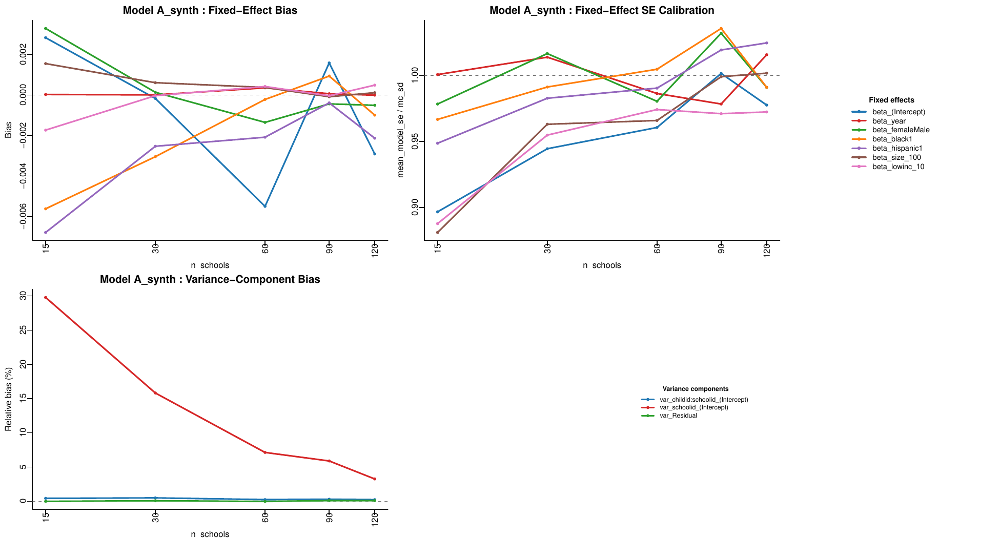
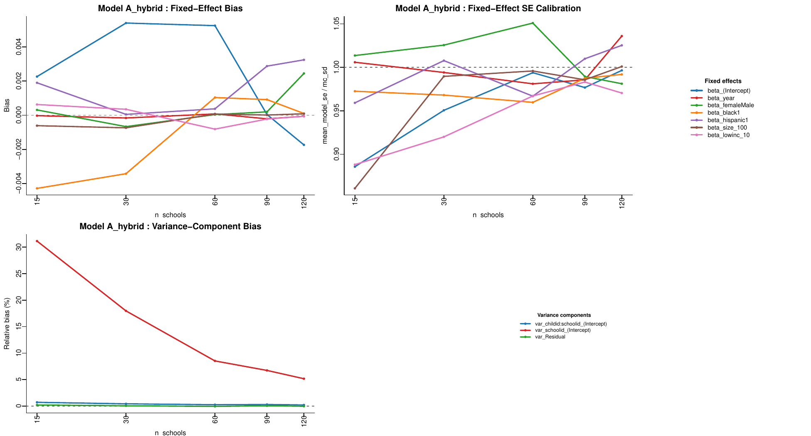
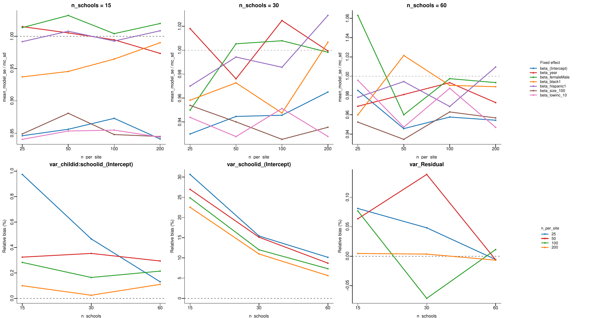

```{r setup, include=FALSE}
knitr::opts_chunk$set(echo = FALSE, warning = FALSE, message = FALSE)
library(knitr)

egsingle <- local({
  e <- new.env()
  utils::data("egsingle", package = "mlmRev", envir = e)
  e$egsingle
})

synth_summary <- readRDS("../tests/synthetic_calibration_summary.rds")
fixedn_summary <- readRDS("../tests/synthetic_fixed_n_summary.rds")
hybrid_summary <- readRDS("../tests/hybrid_plasmode_summary.rds")
hybrid_fixedn_summary <- readRDS("../tests/hybrid_plasmode_fixed_n_summary.rds")
```

# Purpose

This report documents Goal 5a of the RESI mixed-model extension project (see
`instructions/instructions.md` and `log/claudeLog.md` at the repository root):
a calibration check of the simulation machinery for `lme4::lmer` before any
RESI confidence-interval theory is layered on top. It collects, in one
place: the dataset used, the simulation settings, the diagnostics that
identified a fixed-effect SE mis-calibration under full bootstrap
resampling of the real data, and the **hybrid plasmode simulation**, which
is now the primary validation method for calibration going forward (see
the note below).

# Note: full bootstrap (plasmode) resampling does not produce consistent SEs

Earlier work in this project ran `longitudinalCalibrationSim()`, which
resamples the real `egsingle` data with a two-stage **with-replacement**
cluster bootstrap (draw schools with replacement, then draw children with
replacement within each drawn school) and refits Model A/B on each
resampled dataset. That full-bootstrap approach produced fixed-effect
model-based standard errors that were **not** consistent with the true
(Monte Carlo) sampling variability of the estimates: `mean_model_se / mc_sd`
plateaued well below 1 for child- and occasion-level covariates (`female`,
`black`, `hispanic`, `year`), and the between-school variance component
(`var_schoolid`) showed substantial, growing bias as the number of
resampled schools grew. This pattern held on both the real data and a
synthetic dataset generated from the same fitted model, and was not fully
resolved by decoupling the number of sites from the number of subjects per
site (see the diagnostic sections below for that history).

**Simon's hypothesis:** this failure is caused by real slope variation
across the sampling levels (e.g. schools and children have their own,
slightly different coefficients for covariates such as `year`, `female`,
`black`, `hispanic`) that is **not included in the model formula** (Model A
only has random intercepts, not random slopes, for these covariates). When
the real data is resampled with replacement, this unmodeled cross-level
slope heterogeneity is present in every replicate and inflates the true
sampling variability of the fixed-effect estimates beyond what the fitted
model's SE formula -- which assumes the random-intercept-only structure is
correct -- can capture. This is consistent with the slope-heterogeneity
diagnostic below, which found that removing true slope heterogeneity from
the data-generating process (a synthetic outcome simulated directly from
Model A's own fitted parameters, with no unmodeled heterogeneity by
construction) recovers correct SE calibration.

**Going forward, the hybrid plasmode simulation (BLUP-resampled random
effects; see the dedicated section below) is the primary method used to
validate calibration.** It keeps a fixed covariate design (so no unmodeled
cross-level slope heterogeneity can enter) while still using empirically
estimated (resampled, rescaled) random effects rather than a fully
parametric Normal draw, and it reproduces correct SE calibration. The raw
full-bootstrap plasmode results and code are no longer included in this
report; they remain available in `tests/` and `RESI/R/simulations.R` for
reference if needed.

# Dataset: `mlmRev::egsingle`

`egsingle` is a 3-level growth-curve dataset (measurement occasion nested in
child nested in school) used as the plasmode base because it is the only
dataset found (across `lme4`, `nlme`, `geepack`, `mlmRev`, `JM`, `joineR`,
`merTools`) with >=1000 independent subjects, a continuous repeated-measures
outcome, and a continuous time covariate suitable for a smooth term.

## Overall size

```{r dataset-size}
size_tab <- data.frame(
  Quantity = c("Schools", "Children", "Measurement occasions (rows)"),
  N        = c(length(unique(egsingle$schoolid)),
               length(unique(egsingle$childid)),
               nrow(egsingle))
)
kable(size_tab, caption = "Overall dataset size")
```

## Children per school

```{r children-per-school}
n_per_school <- table(egsingle$schoolid[!duplicated(egsingle$childid)])
cps <- as.numeric(n_per_school)
cps_tab <- data.frame(
  Min = min(cps), `1st Qu.` = quantile(cps, 0.25), Median = median(cps),
  Mean = round(mean(cps), 2), `3rd Qu.` = quantile(cps, 0.75),
  Max = max(cps), SD = round(sd(cps), 2), check.names = FALSE
)
rownames(cps_tab) <- NULL
kable(cps_tab, caption = "Distribution of children per school (60 schools)")
```

Every one of the 60 schools has at least 5 children, up to 89, with a mean of
28.7 and median of 24 children per school (SD 18.1) -- a right-skewed,
moderately variable cluster-size distribution, which is why the plasmode
resampling below draws each school's *own* number of children (not a fixed
number) when it is resampled.

## Variables

```{r variable-table}
var_tab <- data.frame(
  Variable   = c("schoolid", "childid", "year", "grade", "math", "retained",
                 "female", "black", "hispanic", "size", "lowinc", "mobility"),
  Level      = c("3 (school, n=60)", "2 (child, n=1721)",
                 "1 (occasion, n=7230 rows)", "1 (occasion)", "1 (occasion)",
                 "1 (occasion)", "2 (child)", "2 (child)", "2 (child)",
                 "3 (school)", "3 (school)", "3 (school)"),
  Type       = c("factor", "factor", "continuous", "continuous (0-4)",
                 "continuous", "binary factor", "binary factor",
                 "binary factor", "binary factor", "continuous",
                 "continuous", "continuous"),
  Description = c(
    "school identifier",
    "child identifier, nested in school",
    "time, centered (range -2.5 to 2.5, integer steps)",
    "grade level, collinear with year",
    "outcome: math achievement score",
    "held back a grade (mostly time-invariant)",
    "child sex", "child race indicator", "child ethnicity indicator",
    "school enrollment size", "% low income at school",
    "% student mobility at school"),
  stringsAsFactors = FALSE
)
kable(var_tab, caption = "egsingle variables and nesting structure")
```

# Simulation design

## Fixed-divisor covariate rescaling

`size` (school enrollment, range 113-1486, SD 312.6) is on a very different
scale from the other covariates and caused an `lme4` convergence warning when
used raw. Both `size` and `lowinc` are rescaled by a **fixed divisor** (not a
z-score), applied identically to every replicate, so coefficients stay
directly interpretable:

- `size_100 = size / 100` (school enrollment in hundreds of students)
- `lowinc_10 = lowinc / 10` (percent low-income in units of 10 percentage points)

Combined with `lmerControl(optimizer = "bobyqa", optCtrl = list(maxfun = 2e5))`,
both models below fit with 0 convergence warnings on the full data.

## Models A and B

Shared fixed effects:
`math ~ year + female + black + hispanic + size_100 + lowinc_10`

- **Model A** (random intercepts only):
  `+ (1 | schoolid/childid)`
- **Model B** (random slope for `year` at the child level):
  `+ (1 + year | childid) + (1 | schoolid)`

All models are fit with `REML = FALSE` (maximum likelihood), since the
full-data fit's fixed effects and variance components are used as the
"truth"/population target that each replicate is compared against (the same
convention `insurancePlasmodeSim()`/`simCalibrationSim()` use for `lm`/`glm`).

## Two-stage hierarchical plasmode resampling (deprecated)

An earlier version of this simulation resampled the real data directly in
two stages (schools with replacement, then children with replacement within
each drawn school). As documented in the note above, this full-bootstrap
approach does not produce fixed-effect SEs consistent with the true
sampling variability, so it is no longer used for calibration; see
`RESI/R/simulations.R` (`.longSimResampleHierarchical()`) for the
implementation if needed for reference.

Random-effect (variance component) standard errors are **not** computed by
any of the simulations below; only fixed-effect model-based SEs are
compared against the Monte Carlo SD of each fixed effect across replicates.
Variance-component point estimates are still tracked for bias.

# Slope-heterogeneity diagnostic (synthetic DGP)

## Motivation and method

**Hypothesis:** minor real variation in schools' *own* coefficients for
covariates other than the intercept (which Model A cannot model, since it
only has random intercepts) is being absorbed into the fixed-effect sampling
variability, causing the SE mis-calibration under full bootstrap resampling
described in the note above (this is Simon's hypothesis for that failure).

**Test:** `tests/test_egsingle_synthetic_calibration.R` fits Model A once to
the real data to obtain the fixed effects, school-intercept variance,
child-intercept variance, and residual variance. For each of 1000 replicates
and each requested `n_schools`, it keeps a deterministic covariate design,
draws fresh school random intercepts from
$N(0, \widehat{\sigma}^2_{school})$, draws fresh child random intercepts from
$N(0, \widehat{\sigma}^2_{child})$, and draws fresh observation errors from
$N(0, \widehat{\sigma}^2_e)$. It then constructs
$math = X\widehat{\beta} + b_{school} + b_{child} + e$ and fits Model A.
There is **no site or subject resampling** in this synthetic simulation.
When `n_schools` exceeds the 60 observed site covariate patterns, the fixed
design cycles those patterns and re-keys the generated sites; this is a
design choice, not random resampling.

## Results

```{r fig-synth, fig.cap="Model A refit on the synthetic (zero true slope heterogeneity) dataset: fixed-effect bias, SE calibration, and variance-component bias vs. n_schools."}

```

## Interpretation

- **Fixed-effect SE calibration is largely recovered.** Across
  `n_schools = 15, 30, 60, 90, 120`, the corrected fresh-DGP `se_ratio` is
  approximately 0.83-1.05 for the fixed effects, including `year`, `female`,
  `black`, and `hispanic`; there is no persistent decline like the earlier
  resampling-based synthetic results.
- The remaining mild deviations from 1 are ordinary finite-Monte-Carlo and
  finite-design effects, especially for the intercept and school-level
  covariates at `n_schools = 15`; they are not the earlier severe
  child/occasion-level pattern.
- Variance-component estimates are close for the child and residual terms.
  The school variance has positive relative bias at smaller site counts
  (about 33% at 15 sites, 15% at 30, and 9% at 60), then stabilizes around
  8-9% for 90 and 120 sites. This is a separate variance-component
  estimation issue, not evidence that the fixed-effect SEs are wrong.

# Sample-size (`n_schools` vs. `n_per_site`) diagnostic

## Motivation and method

The corrected fixed-site-size simulation
(`tests/test_egsingle_synthetic_fixed_n.R`) uses the same direct DGP
generation, but constructs a deterministic covariate design with exactly
`n_per_site` child profiles per site. For each of the 12 grid cells
(`n_schools in {15, 30, 60} x n_per_site in {25, 50, 100, 200}`) and each of
1000 replicates, it draws fresh school effects, fresh child effects, and
fresh residual errors from the fitted Normal variance components, constructs
the outcome from the fixed effects plus those draws, and fits Model A. It
does **not** sample sites or subjects with replacement.

## Results

```{r fixedn-se-table}
fe <- fixedn_summary[grepl("^beta_", fixedn_summary$param), ]
wide <- reshape(fe[, c("param", "n_schools", "n_per_site", "se_ratio")],
                 idvar = c("param", "n_schools"), timevar = "n_per_site", direction = "wide")
wide <- wide[order(wide$param, wide$n_schools), ]
kable(wide, digits = 3, row.names = FALSE,
      caption = "mean_model_se / mc_sd by fixed effect, n_schools, and n_per_site (synthetic DGP, Model A)")
```

```{r fixedn-vc-table}
vc <- fixedn_summary[!grepl("^beta_", fixedn_summary$param), ]
vc$rel_bias_pct <- 100 * vc$bias / vc$truth
widevc <- reshape(vc[, c("param", "n_schools", "n_per_site", "rel_bias_pct")],
                    idvar = c("param", "n_schools"), timevar = "n_per_site", direction = "wide")
widevc <- widevc[order(widevc$param, widevc$n_schools), ]
kable(widevc, digits = 2, row.names = FALSE,
      caption = "Variance-component relative bias (%) by n_schools and n_per_site (synthetic DGP, Model A)")
```

```{r fig-fixedn, fig.cap="Top row: fixed-effect SE calibration vs. n_per_site, one panel per n_schools. Bottom row: variance-component relative bias vs. n_schools, one line per n_per_site."}
knitr::include_graphics("synthetic_diagnostic/figures/longitudinal_calibration_fixedN.png")
```

## Interpretation

- **Fixed-effect SE calibration is approximately correct across the entire
  grid.** The fresh-DGP `se_ratio` values for `year`, `female`, `black`, and
  `hispanic` are about 0.94-1.07 across all combinations of `n_schools` and
  `n_per_site`; the earlier collapse with increasing `n_per_site` disappears.
- The intercept and school-level covariates are somewhat lower at 15 sites
  (roughly 0.84-0.88) and approach 1 as the number of sites increases, which
  is consistent with ordinary small-site behavior rather than an
  `n_per_site`-driven collapse.
- Child-intercept and residual variance estimates are essentially unbiased
  across the grid. School-intercept variance has positive bias at 15 sites
  (about 23-32%), decreasing to about 5-9% by 60 sites; this is a
  variance-component estimation pattern, not fixed-effect SE
  mis-calibration.
- **Conclusion:** once each replicate draws fresh school effects, child
  effects, and residual errors from the fitted DGP, while the covariate
  design is held fixed and no rows are resampled, the severe synthetic
  fixed-effect SE discrepancy disappears. The earlier synthetic results
  were measuring a different procedure and should be replaced by these
  direct-DGP results.

# Hybrid plasmode simulation (BLUP-resampled random effects)

## Motivation and method

The direct-DGP synthetic simulations above draw school and child random
effects from a **Normal** distribution with variance equal to the fitted
variance component. This section tests a middle ground between that fully
parametric approach and the real-data plasmode bootstrap: keep the fixed
covariate design and residual-error generation exactly as in the direct-DGP
synthetic simulation, but generate the school and child random effects by
**resampling with replacement from the model's BLUPs**
(`lme4::ranef()`, the estimated random-effect means) instead of drawing
from a Normal distribution.

Raw BLUPs are shrunk toward zero relative to the true random-effect
variance (a well-known property of best linear unbiased prediction), so
each BLUP pool is first centered to exactly mean zero and then rescaled so
its variance equals the corresponding fitted variance component before any
resampling:
$$b^*_i = (b_i - \bar b) \times \sqrt{\hat\sigma^2 / \widehat{\mathrm{Var}}(b - \bar b)}$$
For Model A fit to the real data: the 60 school BLUPs have raw variance
0.056 (fitted `var_schoolid` = 0.079, so rescale factor $\approx 1.19$); the
1721 child BLUPs have raw variance 0.562 (fitted
`var_childid:schoolid` = 0.652, rescale factor $\approx 1.08$). Each
replicate then draws the school effect for every generated site (with
replacement, from the rescaled 60-value school-BLUP pool) and the child
effect for every generated child (with replacement, from the rescaled
1721-value child-BLUP pool); residual errors are still drawn fresh from
$N(0,\hat\sigma_e^2)$ as in the direct-DGP synthetic simulation. No rows of
the real data are resampled -- only the (rescaled) random-effect values
are. Both grids are rerun with this design:
`tests/test_egsingle_hybrid_plasmode.R` (`n_schools in {15,30,60,90,120}`)
and `tests/test_egsingle_hybrid_plasmode_fixed_n.R`
(`n_schools in {15,30,60} x n_per_site in {25,50,100,200}`), `nsim = 1000`
each.

## Results

```{r hybrid-se-table}
fe <- hybrid_summary[grepl("^beta_", hybrid_summary$param), ]
wide <- reshape(fe[, c("param", "n_schools", "se_ratio")],
                 idvar = "param", timevar = "n_schools", direction = "wide")
kable(wide, digits = 3, row.names = FALSE,
      caption = "mean_model_se / mc_sd by fixed effect and n_schools (hybrid plasmode, Model A)")
```

```{r fig-hybrid, fig.cap="Hybrid plasmode (BLUP-resampled random effects), Model A: fixed-effect bias, SE calibration, and variance-component bias vs. n_schools."}

```

```{r hybrid-fixedn-se-table}
fe2 <- hybrid_fixedn_summary[grepl("^beta_", hybrid_fixedn_summary$param), ]
wide2 <- reshape(fe2[, c("param", "n_schools", "n_per_site", "se_ratio")],
                 idvar = c("param", "n_schools"), timevar = "n_per_site", direction = "wide")
wide2 <- wide2[order(wide2$param, wide2$n_schools), ]
kable(wide2, digits = 3, row.names = FALSE,
      caption = "mean_model_se / mc_sd by fixed effect, n_schools, and n_per_site (hybrid plasmode, Model A)")
```

```{r hybrid-fixedn-vc-table}
vc3 <- hybrid_fixedn_summary[!grepl("^beta_", hybrid_fixedn_summary$param), ]
vc3$rel_bias_pct <- 100 * vc3$bias / vc3$truth
widevc3 <- reshape(vc3[, c("param", "n_schools", "n_per_site", "rel_bias_pct")],
                    idvar = c("param", "n_schools"), timevar = "n_per_site", direction = "wide")
widevc3 <- widevc3[order(widevc3$param, widevc3$n_schools), ]
kable(widevc3, digits = 2, row.names = FALSE,
      caption = "Variance-component relative bias (%) by n_schools and n_per_site (hybrid plasmode, Model A)")
```

```{r fig-hybrid-fixedn, fig.cap="Hybrid plasmode (BLUP-resampled random effects), Model A: top row fixed-effect SE calibration vs. n_per_site (one panel per n_schools); bottom row variance-component relative bias vs. n_schools (one line per n_per_site)."}

```

## Interpretation

- **Fixed-effect SE calibration matches the direct-DGP synthetic results.**
  Across both grids, `se_ratio` is approximately 0.84-1.05 for every fixed
  effect, with no collapse as `n_per_site` increases -- the severe
  mis-calibration seen under full bootstrap resampling of the real data
  (see the note near the top of this report) does not appear here, even
  though random effects are now drawn by resampling (with replacement)
  rather than from a Normal distribution.
- **`var_schoolid_(Intercept)` bias also matches the direct-DGP pattern:**
  positive and shrinking with `n_schools` (about 31% at 15 sites down to
  about 5% at 120 sites, or 5-6% at 60 sites across all `n_per_site`
  values), essentially flat across `n_per_site` -- not the negative,
  growing-with-`n_schools` pattern seen under full bootstrap resampling.
- `var_childid:schoolid_(Intercept)` and `var_Residual` remain well
  calibrated (a few tenths of a percent) across both grids.
- **Conclusion:** resampling with replacement from a *rescaled* finite pool
  of BLUPs behaves like drawing from the underlying Normal distribution for
  this purpose -- it does **not** reproduce the full-bootstrap plasmode's
  fixed-effect SE collapse or its sign-flipped, `n_schools`-growing
  `var_schoolid` bias. This indicates those full-bootstrap-specific
  patterns come from resampling entire rows/clusters of the real, finite
  dataset (with their attendant duplication of full covariate-and-residual
  blocks, and the unmodeled cross-level slope heterogeneity that comes
  along with them per Simon's hypothesis above), not merely from using a
  finite, resampled -- as opposed to continuously distributed -- source for
  the random effects. This is why the hybrid plasmode simulation is now the
  primary calibration validation method: it retains empirically estimated
  random effects while avoiding the unmodeled slope heterogeneity that a
  full bootstrap of the real rows reintroduces.

# Open questions / next steps

- Simon's slope-heterogeneity hypothesis (see the note above) explains why
  full bootstrap resampling of the real data fails to produce consistent
  SEs, but has not been separately, directly confirmed for every affected
  term (it fully explains `year`'s mis-calibration in the earlier
  slope-heterogeneity diagnostic, but not the full extent of the
  child-level-covariate or `var_schoolid` patterns). The hybrid plasmode
  simulation sidesteps this by construction (fixed covariate design, so no
  unmodeled cross-level slope heterogeneity can enter) rather than
  requiring a full resolution of the hypothesis.
- These findings are directly relevant to the open Goal 2 design question
  about the effective sample size `n` for L-RESI: a single "number of
  schools" (or "number of children") scaling will not correctly calibrate
  SEs for *all* fixed effects simultaneously in this 3-level design; the
  correct unit plausibly differs by which level a covariate varies at.
- Decide whether `n_schools`/`n_per_site` values that exceed the real pool
  size (60 schools; ~5-89 children per school) should be dropped from
  future hybrid-plasmode sweeps or are informative as-is.
